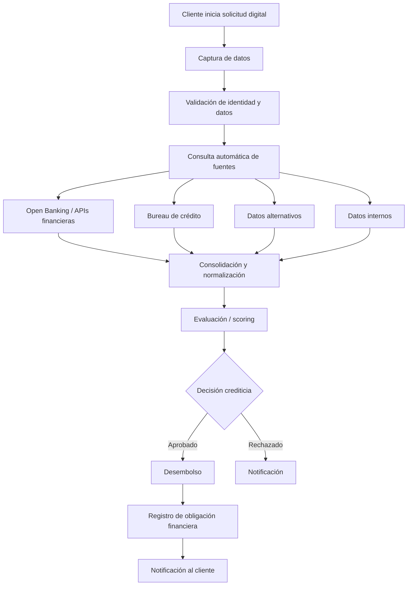

# FinData Credit — Proceso TO-BE

## 1. Propósito
Definir el proceso futuro que debe soportar la estrategia de FinData.

## 2. Flujo TO-BE

## 3. Características
- Solicitud mediante canal digital.
- Validación de información.
- Integración automática con múltiples fuentes.
- Consolidación de información para evaluación.
- Evaluación automatizada de riesgo.
- Decisión crediticia controlada y trazable.
- Desembolso para solicitudes aprobadas.
- Registro de la obligación financiera.
- Notificación del resultado.

## 4. Información utilizada
- Datos del cliente.
- Datos de identidad.
- Información financiera.
- Información de bureau.
- Datos alternativos.
- Información interna.
- Resultado del scoring.
- Decisión crediticia.
- Información del desembolso y obligación.

## 5. Restricción documental
La documentación base todavía no define umbrales de scoring, tasas, montos máximos, reglas detalladas de elegibilidad ni excepciones. Estos elementos deberán levantarse posteriormente como requisitos de negocio.
